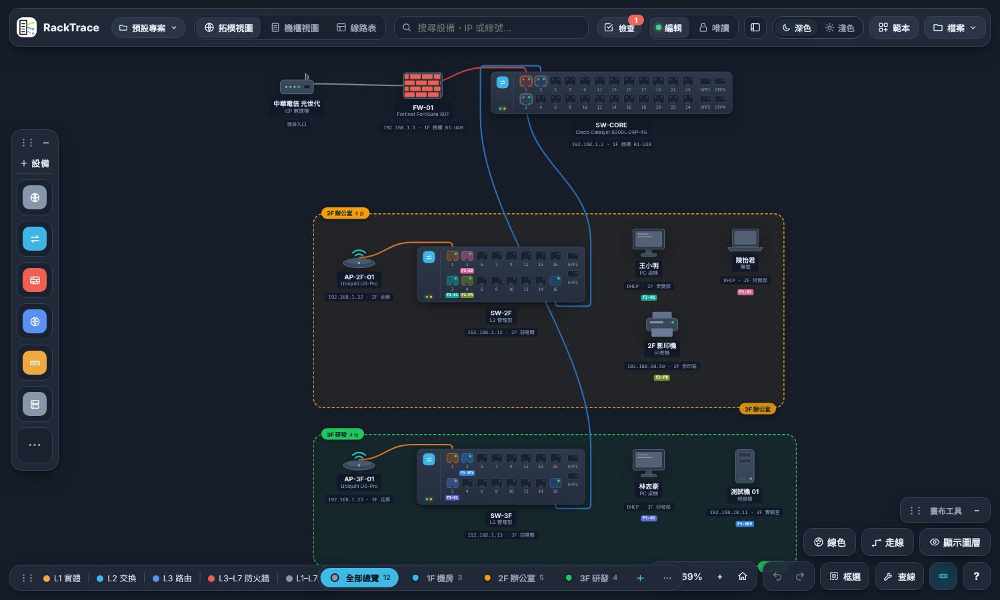

<picture><source media="(prefers-color-scheme: dark)" srcset="racktrace-wordmark-dark.svg"></picture>

**English** · [繁體中文](#繁體中文)

## English

**RackTrace is a network documentation tool for IT teams: draw your racks, switches, patch panels and wall jacks, then click any port to trace the whole cable path, from a switch port through the patch panel and wall jack to the PC.** It also ships an optional Windows service that discovers devices over SNMP/LLDP and monitors live traffic.

> The interface and manual are currently in Traditional Chinese only.

**[▶ Try it in your browser (no install)](https://coloplay1.github.io/netmap/)** — pick *Examples → 三層樓辦公室（多樓層）* on the start page for a three-floor demo. Everything stays in your browser (localStorage); nothing is uploaded.

### Highlights

- **Port-to-port tracing**: click a port and the full path lights up, across floors and pages.
- **Multi-floor overview**: split a site into pages (floors, server rooms, branches) and see all of them on one map, with colored regions per floor; box-select devices and move them between floors.
- **Fault tracing**: pick the failing device, get every segment to the uplink, built-in health checks (VLAN mismatch, PoE, LACP, cable length…) and a blast-radius simulation.
- **SNMP discovery**: LLDP/CDP, IF-MIB, Q-BRIDGE, PoE, LAG, MAC/ARP tables; v1/v2c/v3.
- **Live monitoring**: per-port traffic and MRTG-style graphs, ping heartbeat, NetFlow/IPFIX/sFlow top talkers, alerts to Telegram/Discord/Slack/Teams/LINE/email.
- **Documentation outputs**: rack view, cable table, label printing (QR codes), CSV/SVG/PNG/JSON export, version history.

### Architecture

| Part | What it is |
| --- | --- |
| Web app | A single `index.html` (vanilla JS, no build step, no dependencies), hosted on GitHub Pages. Data lives in the browser. |
| Local service | `tools/netmap-snmp/` — Python (`netmap_server.py`, `netmap_snmp.py`, …): serves the same page, stores the map and metrics in SQLite, scans via SNMP, polls ping/SNMP/SSH, receives flow exports. Only Python standard library for SNMP v1/v2c. |
| Windows packaging | PyInstaller `netmap.exe` and an Inno Setup installer (`RackTrace-Setup.exe`) that registers a start-at-boot background service. |
| CI | GitHub Actions on Windows runs self-tests (collectors, flow parsing, ping/alerts/history/permissions), builds the executables, silently installs the installer, checks that the service answers, uninstalls it, and publishes the release assets. |

Security notes: SNMP/SSH credentials are encrypted with Windows DPAPI; scan and update APIs accept only local administrator requests; the installer offers a Windows Firewall rule for LAN access (private/domain networks only) that you can untick.

### Install (Windows service, optional)

1. Download [`RackTrace-Setup.exe`](https://github.com/coloplay1/netmap/releases/latest/download/RackTrace-Setup.exe) from [Releases](https://github.com/coloplay1/netmap/releases/latest).
2. Run it. The service starts at boot; open `http://127.0.0.1:18080/`.
3. Windows' Smart App Control may block unsigned programs; see the [manual](https://coloplay1.github.io/netmap/manual.html#e-setup) (the code is fully open, there is no paid code-signing certificate).

Or run from source: `python tools/netmap-snmp/netmap_server.py` (Python 3.8+).

### Documentation

[Manual (HTML, Traditional Chinese)](https://coloplay1.github.io/netmap/manual.html) · [PDF](https://coloplay1.github.io/netmap/RackTrace-manual.pdf) · [Full feature list](docs/FEATURES.zh-TW.md) · [Changelog](https://coloplay1.github.io/netmap/manual.html#changelog)

### License

[MIT](LICENSE)

---

## 繁體中文

**RackTrace（機房線路對應圖）是給 IT 用的網路線路文件工具**：畫出機櫃、Switch、配線架、資訊座與終端設備，點任何一個網路埠，就能追蹤「Switch 埠 ➔ 配線架 ➔ 資訊座 ➔ 電腦」的整條路徑。另有選用的 Windows 常駐服務，可用 SNMP／LLDP 自動掃描設備並監控即時流量。

**[▶ 線上試玩（免安裝）](https://coloplay1.github.io/netmap/)** — 在開始頁選「範例 ▸ 三層樓辦公室（多樓層）」，馬上看到三個樓層的示範。資料只存在你的瀏覽器，不會上傳。

### 重點功能

- **埠對埠查線**：點埠就亮出整條路徑，可跨樓層、跨頁面。
- **多樓層總覽**：把一個據點分成多頁（樓層、機房、分公司），在「全部總覽」用彩色虛線框標出每個樓層；框選設備後可直接劃進樓層。
- **故障查線**：點有問題的設備，列出到網路入口的每一段，內建健檢（VLAN 不一致、PoE、LACP、線長…）與「如果這台壞了」的影響範圍模擬。
- **SNMP 自動掃描**：LLDP／CDP、IF-MIB、Q-BRIDGE、PoE、LAG、MAC／ARP 表；支援 v1／v2c／v3。
- **即時監控**：每個埠的流量與 MRTG 風格曲線、Ping 心跳、NetFlow／IPFIX／sFlow 流量排行、告警送到 Telegram／Discord／Slack／Teams／LINE／Email。
- **文件產出**：機櫃視圖、線路表、線標列印（含 QR Code）、CSV／SVG／PNG／JSON 匯出、歷史版本。

### 架構

| 部分 | 說明 |
| --- | --- |
| 網頁版 | 單一 `index.html`（原生 JavaScript，免建置、無外部相依），放在 GitHub Pages；資料存在瀏覽器。 |
| 本地服務 | `tools/netmap-snmp/`，Python（`netmap_server.py`、`netmap_snmp.py` 等）：提供同一份網頁、用 SQLite 保存圖與流量、SNMP 掃描、Ping／SNMP／SSH 輪詢、接收流量匯出。SNMP v1／v2c 只用 Python 標準函式庫。 |
| Windows 封裝 | PyInstaller 打包成 `netmap.exe`，加上 Inno Setup 安裝檔 `RackTrace-Setup.exe`（註冊成開機自動啟動的背景服務）。 |
| CI | GitHub Actions 在 Windows 上跑自我測試（收集器、流量解析、Ping／告警／歷史／權限），建置執行檔，並實際靜默安裝安裝檔、確認服務有回應、再解除安裝，最後上傳發佈檔案。 |

安全設計：SNMP／SSH 帳密以 Windows DPAPI 加密；掃描與更新 API 只接受本機管理員；安裝時提供開放內網連線的防火牆規則（只限私人／網域網路），可以取消勾選。

### 安裝（Windows 常駐服務，選用）

1. 從 [Releases](https://github.com/coloplay1/netmap/releases/latest) 下載 [`RackTrace-Setup.exe`](https://github.com/coloplay1/netmap/releases/latest/download/RackTrace-Setup.exe)。
2. 執行安裝，服務會開機自動啟動；用瀏覽器開 `http://127.0.0.1:18080/`。
3. 若被「智慧型應用程式控制」擋下，請看[手冊](https://coloplay1.github.io/netmap/manual.html#e-setup)（程式碼完全公開，沒有付費簽章）。

也可以從原始碼執行：`python tools/netmap-snmp/netmap_server.py`（需要 Python 3.8 以上）。

### 文件

[使用手冊（網頁）](https://coloplay1.github.io/netmap/manual.html) · [PDF](https://coloplay1.github.io/netmap/RackTrace-manual.pdf) · [完整功能清單](docs/FEATURES.zh-TW.md) · [版本紀錄](https://coloplay1.github.io/netmap/manual.html#changelog)

### 授權

[MIT](LICENSE)
